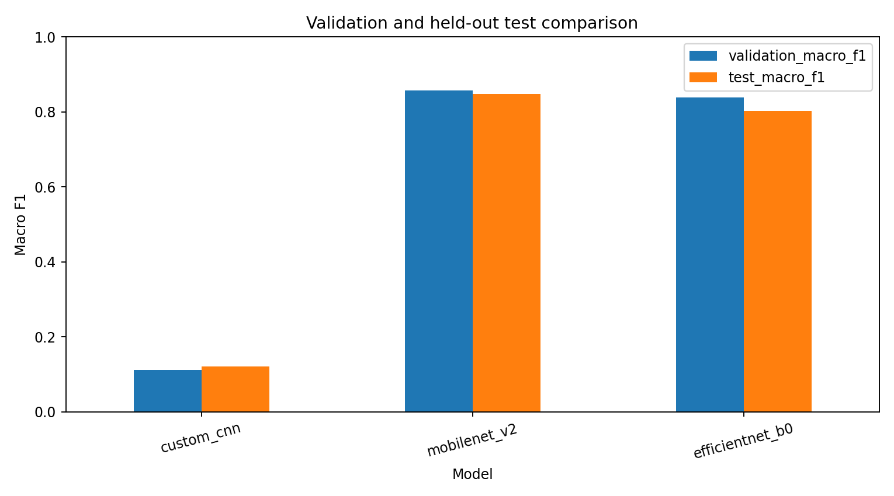
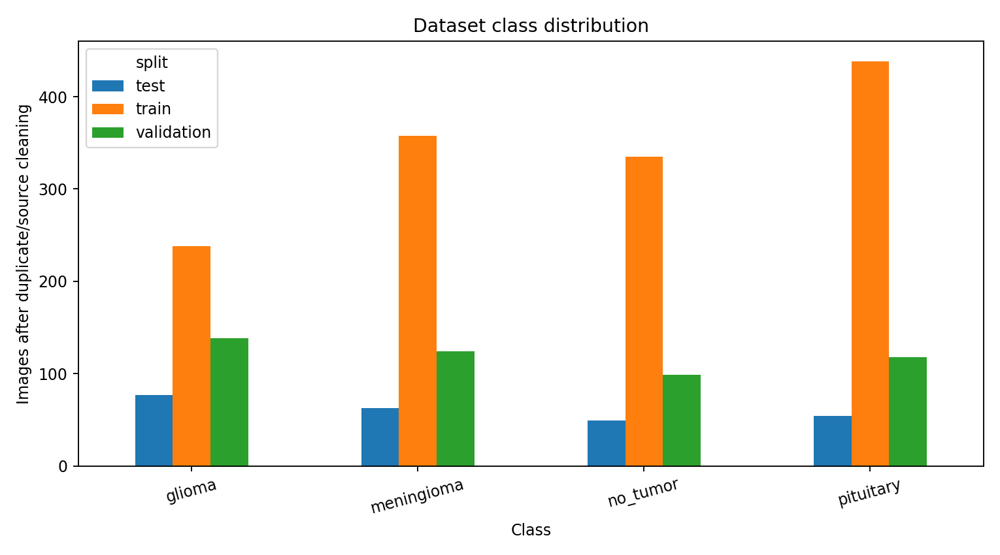

# Brain Tumor MRI Image Classification

## Objective

Compare a custom convolutional network with ImageNet transfer learning for four MRI image classes and provide a Streamlit research demonstration.

## Dataset and cleaning

Assigned source: https://drive.google.com/drive/folders/1C9ww4JnZ2sh22I-hbt45OR16o4ljGxju?usp=sharing

Classes: glioma, meningioma, no_tumor, pituitary.

Readable source images: 2443. Retained: 2091. Excluded: 352.

Exact decoded-pixel duplicates and Roboflow source-name families were grouped. One image per family was retained, prioritizing test, validation, then train. Conflicting-label families were excluded. See data_manifest.csv and excluded_images.csv.

## Method

Images are decoded as RGB, corrected for EXIF orientation, and resized with PIL bilinear interpolation. Training uses mild rotation, zoom, translation, horizontal flipping and brightness changes. Validation and test images are never augmented. Normalization is embedded in each saved model: custom CNN 0–1, MobileNetV2 −1–1, and EfficientNetB0's built-in preprocessing on raw 0–255 input.

Balanced class weights, dropout, batch normalization, early stopping, learning-rate reduction and best-validation-loss checkpoints are used. The transfer backbones are initially frozen; optional final-layer fine-tuning keeps batch normalization frozen.

## Model comparison

| Model | Validation accuracy | Validation macro F1 | Test accuracy | Test macro F1 | Parameters | Inference ms |
|---|---:|---:|---:|---:|---:|---:|
| custom_cnn | 0.2881 | 0.1118 | 0.3169 | 0.1203 | 423,268 | 20.68 |
| mobilenet_v2 | 0.8580 | 0.8568 | 0.8477 | 0.8483 | 2,422,468 | 208.18 |
| efficientnet_b0 | 0.8392 | 0.8384 | 0.8025 | 0.8030 | 4,214,055 | 373.44 |

Selected deployment model: **mobilenet_v2**, chosen by validation macro F1 (validation accuracy, then parameter count break ties) before computing test metrics.

Test accuracy, macro precision, macro recall, macro F1, per-class results and confusion matrices are stored in the results files. Latency is the mean of ten warmed single-image forward passes on the recorded runtime; it is not an end-to-end web latency measurement.

## Deployment

Run `streamlit run app.py` from the project folder. The application reads artifacts/deployment/model.keras and its metadata, and uses the same RGB and resize code as training. It shows all four softmax scores; these are not calibrated clinical probabilities.

## Limitations

This is an image classification educational prototype, not a diagnostic or triage system. Patient IDs are not supplied, so patient-level independence cannot be verified. The cleaning does not detect every near duplicate. Results on this small curated dataset do not establish performance on other hospitals, scanners, populations, MRI sequences, or non-MRI uploads. A no_tumor prediction is not evidence that a person is tumor-free. Independent patient-level external validation, probability calibration, and clinical review would be needed before any medical use.

## Reproducibility

See run_config.json, environment.json, class_names.json, the retained-image manifest, training history CSVs, and test_predictions.csv. A fixed seed improves repeatability; hardware and library differences can still change training results.

## Dataset attribution

The supplied README identifies Labeled MRI Brain Tumor Dataset Version 1 by the Roboflow user Ali Rostami and CC BY 4.0. Original page: https://universe.roboflow.com/ali-rostami/labeled-mri-brain-tumor-dataset . The provider's labeling statements have not been independently verified.
